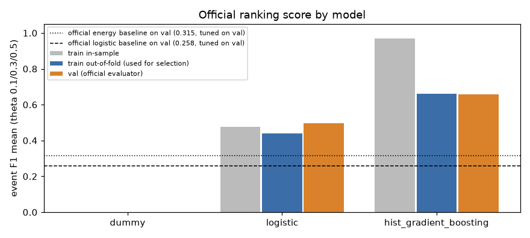
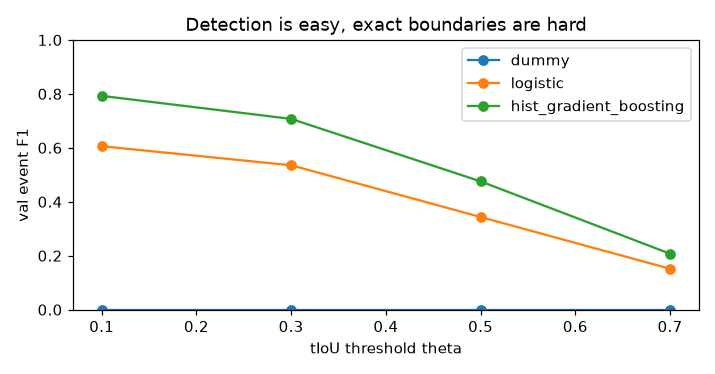
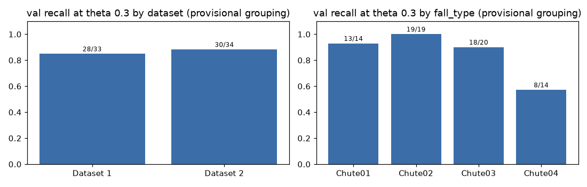
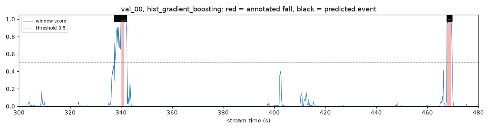
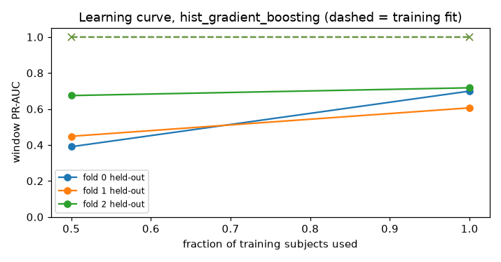
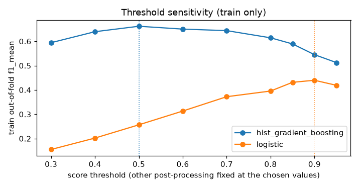

# Báo cáo NV3 — Hướng tiếp cận và kết quả baseline

*Người thực hiện: sangkhoi · Ngày: 2026-10-22 · Dữ liệu: `abc2027_uwb_train_v1` · Run: `outputs/experiments/20261022-152626_baseline`, chạy từ commit sạch `2d7a55c` (`dirty: false`). Thư mục run chỉ lưu trên máy, không commit. Bản này đã cập nhật sau lượt rà soát độc lập (mục 11).*

Notebook tái lập (chạy được trên Colab): [`notebooks/02_baseline_colab.ipynb`](../notebooks/02_baseline_colab.ipynb). Tài liệu kỹ thuật: [`docs/baseline_pipeline.md`](../docs/baseline_pipeline.md). EDA (NV2): [`reports/eda_preprocessing_report.md`](eda_preprocessing_report.md). Số liệu gốc: [`reports/baseline_results.json`](baseline_results.json).

**Nguồn dữ liệu.** Số liệu và hình trong báo cáo này được nhóm tính và vẽ từ bộ dữ liệu ABC 2027 UWB-FallTrack (`abc2027_uwb_train_v1`), © 2026 LIARA Laboratory, Université du Québec à Chicoutimi, phát hành theo giấy phép [CC BY-NC 4.0](https://creativecommons.org/licenses/by-nc/4.0/). Báo cáo không chứa dữ liệu radar thô. Tuy vậy, một số số liệu và hình **có thông tin nhãn** ở dạng tổng hợp hoặc minh họa, ví dụ số cú ngã theo nhóm và trục thời gian nhãn của một đoạn val trong hình ở mục 7. Báo cáo chỉ dùng cho mục đích phi thương mại.

---

## 1. Tóm tắt

- **Kết quả trên val:** baseline được chọn (HistGradientBoosting trên đặc trưng năng lượng chuyển động) đạt **f1_mean = 0,659**. Đây là điểm xếp hạng chính thức: trung bình F1 sự kiện tại θ = 0,1/0,3/0,5, chấm bằng `evaluate.py` của ban tổ chức với `--ignore-flagged`. Với cùng metric trên val, baseline chính thức đạt 0,315 (energy) và 0,258 (logistic), dù ngưỡng của chúng được tune ngay trên val.
- **Không quyết định nào dựa trên val.** Mô hình, ngưỡng và hậu xử lý đều được chọn bằng cross-validation chia theo người bên trong train, với điểm OOF là **0,662**. Điểm val (0,659) gần như trùng điểm OOF. Có hai điều cần nói rõ:
  - Val đã được chấm cho cả ba mô hình ở ba run (baseline và hai ablation), nên val là tập development, không còn là holdout sạch.
  - Điểm OOF vừa dùng để chọn trong 144 tổ hợp hậu xử lý vừa được báo cáo, nên hơi lạc quan.
- **Phát hiện tốt, định vị biên còn yếu:** F1 là 0,79 ở θ = 0,1 nhưng chỉ 0,48 ở θ = 0,5 và 0,21 ở θ = 0,7. Ở θ = 0,3: recall 0,87, precision 0,60, 19 báo động giả mỗi giờ.
- **Nguồn lỗi chính đo được:** 63% báo động giả nằm trong 3 s sau một chỗ nối đoạn, trong khi vùng này chỉ chiếm 27% thời gian. Cách giải thích hợp lý nhất là phần dư của bộ lọc nền sau mỗi chỗ nối bị nhầm thành chuyển động mạnh, nhưng điều này chưa được kiểm chứng bằng một thí nghiệm tách riêng.
- **Overfit:** HGB khớp gần như hoàn hảo trên train (PR-AUC in-sample 1,00, f1_mean 0,97) nhưng OOF chỉ đạt 0,66. Learning curve vẫn đang đi lên khi thêm người, nên cần thêm sự đa dạng người, regularization, và đặc trưng ít phụ thuộc vào cách ghép luồng.
- **Ablation:** τ = 8 s kém hơn τ = 3 s. Thêm đặc trưng vị trí chỉ tăng OOF 0,008 nhưng tăng val 0,05. Có nên dùng đường tắt này hay không là quyết định của nhóm (mục 10).
- **Sau lượt rà soát độc lập (mục 11):**
  - Đã sửa một lỗi rò rỉ nhỏ trong CV: OOF giảm từ 0,6635 xuống 0,6619.
  - Đã sửa bước làm mượt và cách ghi commit cho mỗi run.
  - Có một phát hiện **chưa áp dụng**: ngưỡng được chọn trên các model fold lại không khớp với model cuối. Nếu suy luận bằng trung bình 3 model fold, val đạt 0,718 thay vì 0,659. Con số này đo trên val sau khi đã cố định mọi lựa chọn, nên chưa được dùng để đổi mô hình.

---

## 2. Bài toán và protocol (đã xác nhận)

- **Đầu vào:** luồng CIR `(3 radar, T, 368 bin)` ở 50 Hz, dài khoảng 29 phút, trộn ADL với các cú ngã.
- **Đầu ra:** mỗi cú ngã được báo thành một dòng `stream_id, t_start, t_end, score[, t_alarm]`.
- **Ghép dự đoán với nhãn:** ghép 1-1 theo `score` giảm dần, là TP nếu tIoU ≥ θ. Cú ngã `quality = low` hoặc `needs_review` là vùng ignore.
- **Xếp hạng:** trung bình F1 tại θ = 0,1/0,3/0,5. Hòa điểm thì so trung vị \|sai số start\| tại θ = 0,3, rồi đến số báo động giả mỗi giờ.

Chi tiết và nguồn: [`docs/challenge_spec.md`](../docs/challenge_spec.md).

---

## 3. Hướng tiếp cận được chọn và lý do

| Hướng | Ưu điểm | Nhược điểm với bộ dữ liệu này | Quyết định |
|---|---|---|---|
| Ngưỡng năng lượng (baseline chính thức) | Đơn giản | Một ngưỡng cố định không phân biệt được ngã với ADL mạnh hay chỗ nối; f1_mean 0,315 dù tune trên val | Chỉ dùng làm mốc so sánh |
| **Phân loại cửa sổ + gom thành sự kiện** | Dễ giải thích, nhanh, kiểm soát được rò rỉ; biên sự kiện nằm trên lưới 0,2 s | Phụ thuộc đặc trưng thủ công; biên bị giới hạn bởi độ dài cửa sổ | **Chọn làm baseline** |
| Mô hình chuỗi (1D-CNN/TCN/BiGRU trên chuỗi năng lượng theo frame) | Học được hình dạng cú ngã và ngữ cảnh dài | Chỉ có 12 nhóm người trong train, dễ overfit; cần baseline tốt để so sánh | Bước tiếp theo |
| Định vị sự kiện kiểu temporal action localization | Hồi quy biên trực tiếp, tốt cho θ cao | Phức tạp, ít dữ liệu | Để sau |

Lý do chọn: kế hoạch NV3 yêu cầu một baseline đơn giản, kiểm tra được và tái lập được trước khi chuyển sang deep learning. Metric là ở mức sự kiện, nên baseline phải đi trọn đường **cửa sổ → sự kiện** và được chấm bằng evaluator chính thức. Không thể chỉ báo cáo metric cửa sổ.

---

## 4. Pipeline

```text
HDF5 (đọc theo khúc 5000 frame)
 → kiểm tra schema/timestamp/NaN/nhãn
 → split chính thức (train | val) + fold theo người trong train
 → trừ nền EMA nhân quả (tau 3 s) → bg_energy, diff_energy theo frame và theo radar (log10)
 → cửa sổ 1 s / bước 0,2 s → 86 đặc trưng thống kê
 → Dummy | Logistic | HistGradientBoosting (class_weight = balanced)
 → score out-of-fold trên train → chọn ngưỡng và hậu xử lý theo f1_mean chính thức
 → fit lại trên toàn bộ train → chấm val bằng evaluate.py (chỉ để báo cáo)
```

Lưới hậu xử lý gồm 144 tổ hợp cho mỗi mô hình: ngưỡng ∈ {0,3…0,95}, làm mượt ∈ {1, 3} cửa sổ, số cửa sổ dương tối thiểu ∈ {1, 2}, khoảng gộp ∈ {0,2; 0,6} s, độ dài tối thiểu ∈ {0,4; 0,8} s.

---

## 5. Thiết lập đánh giá và chống rò rỉ

- **Train:** 13 luồng (6,18 h), 359 cú ngã, 111 216 cửa sổ (3 328 dương, 1 718 mơ hồ bị loại). **Val:** 5 luồng (2,05 h), 119 cú ngã, trong đó **67 được chấm**; 52 cú bị gắn cờ trở thành vùng ignore, kể cả toàn bộ cú ngã của Dataset 3.
- **3 fold chia theo người:**

  | Fold | Người ngã | Người ADL |
  |---|---|---|
  | 0 | 3, 6 | 4, 12 |
  | 1 | 1, 7 | 9, 10 |
  | 2 | 2, 5 | 5, 6 |

  Cửa sổ vắt qua chỗ nối giữa hai fold bị loại khỏi tập train của cả hai fold (purge). Chúng cũng **không được chấm out-of-fold**, vì model nào chấm chúng cũng đã học các cửa sổ dùng chung frame với chúng. Có 6 822 cửa sổ như vậy (6,1%). Bản trước chấm chúng bằng model của fold chiếm đa số, nên bị rò rỉ nhẹ (mục 11).
- **Kiểm tra tự động khi chạy:** không có luồng hay người nào ở cả hai split, không có cửa sổ nào của fold held-out lọt vào tập train, và tập fit cuối chỉ có cửa sổ train. Vi phạm sẽ dừng pipeline với `LeakageError`.
- **Imputer và scaler** nằm trong sklearn Pipeline nên chỉ fit trên dữ liệu train. Ngưỡng và hậu xử lý chỉ được chọn trên score OOF của train.

---

## 6. Kết quả chính



| Mô hình | Train in-sample | **Train OOF** (để chọn) | **Val** f1_mean | F1@0,1 | F1@0,3 | F1@0,5 | F1@0,7 | Báo động giả/giờ @0,3 | PR-AUC cửa sổ val |
|---|---|---|---|---|---|---|---|---|---|
| Dummy (prior) | 0,000 | 0,000 | 0,000 | 0,000 | 0,000 | 0,000 | 0,000 | 0,0 | 0,034 |
| Logistic (C = 0,1) | 0,475 | 0,440 | 0,495 | 0,606 | 0,535 | 0,343 | 0,152 | 38,1 | 0,323 |
| **HistGradientBoosting** | 0,970 | **0,662** | **0,659** | 0,793 | 0,707 | 0,476 | 0,207 | 19,0 | 0,724 |
| *Baseline energy chính thức* | – | – | *0,315* | *0,358* | *0,338* | *0,249* | *0,060* | – | – |
| *Baseline logistic chính thức (4 s)* | – | – | *0,258* | *0,593* | *0,167* | *0,014* | *0,000* | – | – |

Số của hai baseline chính thức lấy từ README của gói. Ngưỡng của chúng được tune trên val, nên là mốc tham chiếu thiên về lạc quan.

**Chi tiết HGB trên val ở θ = 0,3:**

- TP 58, FP 39, FN 9; precision 0,598, recall 0,866.
- tIoU trung bình của các cặp ghép được là 0,58.
- Trung vị \|sai số start\| là 0,34 s; trung vị \|sai số end\| là 0,71 s; 83% sự kiện có start lệch không quá 1 s.
- Độ trễ cảnh báo trung vị là 0,36 s.



**Theo từng luồng val (HGB, f1_mean):**

| Luồng | val_00 | val_01 | val_02 | val_03 | val_04 (5 phút) |
|---|---|---|---|---|---|
| f1_mean | 0,696 | 0,611 | 0,638 | 0,625 | 0,917 |
| Báo động giả/giờ | 16,3 | 28,5 | 22,5 | 12,2 | 0 |



**Recall ở θ = 0,3 theo nhóm** (cách chia nhóm là provisional):

- Dataset 1: 28/33 (0,85); Dataset 2: 30/34 (0,88). Dataset 3 ở val bị ignore toàn bộ.
- Chute01: 13/14; Chute02: 19/19; Chute03: 18/20; **Chute04: 8/14 (0,57)**. Chute04 là loại ngã khó nhất. Cần xem lại tín hiệu của loại này; có thể đó là kiểu ngã chậm hoặc ngã từ tư thế ngồi.

---

## 7. Phân tích lỗi



1. **Biên sự kiện bị kéo rộng.** Trong ví dụ trên, score bắt đầu tăng khoảng 3 s trước cú ngã. Thời điểm đó trùng chỗ nối mở đầu đoạn ngã, vì mỗi đoạn ngã bắt đầu 3–8 s trước cú ngã. Khoảng dự đoán vì thế rộng hơn cú ngã thật (trung vị \|sai số end\| 0,71 s), làm tIoU giảm và F1 tụt mạnh ở θ ≥ 0,5.
2. **Báo động giả sau chỗ nối.** Trên dự đoán OOF của train có 73 sự kiện không gần cú ngã nào:

   | Vùng quanh chỗ nối | Báo động giả trong vùng | % thời gian luồng thuộc vùng |
   |---|---|---|
   | [−0,5; +0,5] s | 3/73 (4,1%) | 8,6% |
   | [−0,5; **+3**] s | **46/73 (63,0%)** | 27,2% |

   Bản thân crossfade 0,2 s không gây báo động. Cách giải thích hợp lý nhất là phần dư EMA giảm dần trong khoảng τ = 3 s sau khi nền tĩnh đổi đột ngột. Đây mới là diễn giải, chưa được kiểm chứng bằng một thí nghiệm tách riêng. Chưa biết tập test có được ghép theo cùng cách hay không: README chỉ nói test, nhãn và danh sách segment của test được giữ kín, và generator công khai không dựng lại test. Nếu test cũng được ghép như vậy, sửa lỗi này sẽ giảm được cả báo động giả lẫn sai số biên.
3. **Chute04** có recall thấp (0,57).
4. **Score cao nhưng không vượt ngưỡng:** có những đỉnh ở mức 0,3–0,4 (ví dụ quanh 400 s trên val_00). Ngưỡng 0,5 được chọn trên OOF của train.

---

## 8. Chẩn đoán overfit và underfit

| Bằng chứng (HGB) | Giá trị | Diễn giải |
|---|---|---|
| PR-AUC cửa sổ: in-sample / OOF / val | 1,000 / 0,664 / 0,724 | Mô hình nhớ gần như hoàn toàn dữ liệu train, nên có **overfit** |
| f1_mean: in-sample / OOF / val | 0,970 / 0,662 / 0,659 | Khoảng cách giữa in-sample và OOF lớn, nhưng **OOF ≈ val**, nên CV vẫn là một ước lượng hợp lý (dù hơi lạc quan vì OOF cũng là tiêu chí chọn) |
| PR-AUC theo fold (held-out) | 0,699 / 0,606 / 0,718 (std 0,049) | Có khác biệt giữa các nhóm người, nhưng ở mức vừa phải |
| Learning curve (50% → 100% số người) | fold 0: 0,39 → 0,70; fold 1: 0,45 → 0,61; fold 2: 0,68 → 0,72 | Vẫn tăng khi thêm người, gợi ý thiếu đa dạng dữ liệu (variance) hơn là mô hình quá yếu. Mỗi mức chỉ dùng một tập con ngẫu nhiên, nên đây là gợi ý, chưa phải kết luận |
| Logistic: in-sample / OOF PR-AUC | 0,380 / 0,336 | Logistic thì ngược lại: **underfit**, vì quan hệ giữa các đặc trưng là phi tuyến |



**Kết luận:** HGB vừa có overfit (khớp quá mức với từng người) vừa bị giới hạn bởi dữ liệu. Điểm val không cao bất thường và không vượt OOF nhiều. Lỗi rò rỉ ở biên fold mà lượt rà soát tìm ra chỉ làm OOF lệch 0,0016 (mục 11). Lưu ý rằng các đường tắt của bộ dữ liệu (vị trí thảm, tỉ lệ frame lặp; xem báo cáo EDA mục 8) có mặt ở cả train lẫn val. Chưa biết chúng có xuất hiện ở test hay không. Vì vậy một điểm số tốt **không** chứng minh mô hình đã học được "cú ngã" theo nghĩa vật lý.

---

## 9. Ngưỡng và hậu xử lý đã chọn (chỉ trên OOF của train)

| Mô hình | Ngưỡng | Làm mượt | Số cửa sổ tối thiểu | Khoảng gộp | Độ dài tối thiểu |
|---|---|---|---|---|---|
| HGB | 0,5 | 3 | 1 | 0,6 s | 0,8 s |
| Logistic | 0,9 | 3 | 2 | 0,6 s | 0,8 s |



Với HGB, đường f1_mean OOF khá phẳng trong khoảng ngưỡng 0,4–0,7, nên lựa chọn ngưỡng không quá nhạy. Với logistic, f1_mean chỉ cao khi ngưỡng rất cao (≥ 0,85), vì `class_weight = balanced` đẩy xác suất của lớp dương lên.

---

## 10. Ablation (chọn bằng OOF của train, val chỉ để báo cáo)

Hai ablation dùng đúng pipeline trên, mỗi lần chỉ đổi một yếu tố bằng `--override`. Trong mỗi ablation, mô hình được chọn vẫn là HGB.

| Cấu hình | Train OOF f1_mean | Val f1_mean | Val F1@0,5 | PR-AUC cửa sổ val |
|---|---|---|---|---|
| **Baseline** (τ = 3 s, không dùng vị trí) | **0,662** | **0,659** | 0,476 | 0,724 |
| τ = 8 s | 0,640 | 0,633 | 0,428 | 0,641 |
| Thêm `range_centroid` (đặc trưng vị trí) | 0,670 | 0,709 | 0,553 | 0,722 |

- **τ = 8 s kém hơn** cả trên OOF lẫn val, dù ở EDA từng đặc trưng τ = 8 s tách lớp tốt hơn (AUC 0,90 so với 0,88). Lý do là phần dư kéo dài hơn sau cú ngã làm biên sự kiện kém chính xác: F1@0,5 giảm từ 0,476 xuống 0,428. Vì vậy giữ τ = 3 s.
- **Đặc trưng vị trí** chỉ tăng OOF thêm 0,008, nhỏ hơn mức dao động giữa các fold. Trên val thì tăng tới 0,05. Nếu theo tiêu chí chỉ dùng train thì không có lý do để bật. Còn nếu bật vì điểm val cao hơn thì chính là đang tune trên val. Đây là **quyết định của nhóm**: `range_centroid` mã hóa vị trí của ba tấm thảm cố định (một đường tắt của bộ dữ liệu, không phải đặc điểm của cú ngã). Chưa có nguồn chính thức nào nói test dùng cùng các tấm thảm. Nếu đúng là vậy, đặc trưng này có thể giúp tăng điểm xếp hạng. Còn nếu không, nó có thể làm điểm giảm. Dù trường hợp nào, nó cũng khiến mô hình kém tổng quát và khó bảo vệ trong paper. Baseline giữ mặc định **tắt**.

---

## 11. Rà soát độc lập và các sửa đổi

Ngày 2026-10-22, một lượt rà soát độc lập (Codex, chạy trên máy có dữ liệu) đã chấm lại kết quả bằng evaluator chính thức, tính lại các số liệu chính từ artifact và đọc lại code. Mọi số liệu chính trong bản trước đều khớp với artifact. Bảng dưới là các phát hiện và cách nhóm xử lý.

| ID | Phát hiện | Xử lý | Ảnh hưởng đo được |
|---|---|---|---|
| R01 | Cửa sổ vắt qua hai fold được chấm OOF bằng model đã học các cửa sổ dùng chung frame với nó | **Đã sửa** (commit `2d7a55c`): các cửa sổ này không được chấm OOF | OOF của HGB 0,6635 → 0,6619. Hậu xử lý được chọn và điểm val không đổi |
| R09 | Bước làm mượt bắc qua cửa sổ bị thiếu | **Đã sửa**: làm mượt trên từng đoạn `w_index` liên tục | Bằng 0 trước khi sửa R01; cần thiết để R01 đúng |
| R06 | Run cũ ghi commit `2ffcffe` kèm `dirty: true`, không truy ngược được về code | **Đã sửa**: chạy lại toàn bộ từ commit sạch; `environment.json` liệt kê file đã sửa và file chưa theo dõi | Không đổi số liệu |
| R02 | Câu "báo cáo không chứa nhãn" không đúng | **Đã sửa** câu ghi nguồn ở cả hai báo cáo | – |
| R04 | Câu "val chỉ chấm một lần" không đúng | **Đã sửa**: val được gọi là tập development | – |
| R07 | OOF vừa là tiêu chí chọn hậu xử lý vừa là con số được báo cáo | **Đã ghi chú**; nested CV để vòng sau | Chưa định lượng |
| R08 | Các câu "test được tạo cùng quy trình" và "đường tắt có ở test" là suy đoán | **Đã sửa** thành giả thuyết | – |
| R03 | Ngưỡng được chọn trên model fold nhưng áp lên model cuối | **Chưa áp dụng**, ghi thành phát hiện (bên dưới) | Val 0,659 → 0,718 nếu dùng trung bình model fold |
| R05 | Mã người suy ra từ tên file, chưa được xác nhận chính thức | Đã có trong câu hỏi gửi ban tổ chức (`docs/challenge_spec.md`) | Cách triển khai nhất quán; không thấy rò rỉ |
| R10 | Notebook Colab clone branch chưa ghim commit; thư viện chưa khóa phiên bản | Để vòng sau | – |
| – | Repo đang public và link Drive của nhóm trong `data/README.md` mở được không cần đăng nhập | Nhóm trưởng quyết định | – |

**Phát hiện R03 (chưa áp dụng).** Ngưỡng 0,5 và hậu xử lý được chọn trên score OOF. Score này đến từ ba model fold, mỗi model chỉ học khoảng 8 trong 12 nhóm người. Model cuối học đủ 12 nhóm nên tự tin hơn, và ngưỡng 0,5 trở nên hơi thấp với nó. Kết quả trên val, đo bằng `scripts/diagnose_fold_ensemble.py --run-dir outputs/experiments/20261022-152626_baseline`:

| Trên val | Model cuối (đang dùng) | Trung bình 3 model fold |
|---|---|---|
| Score cửa sổ trung bình | 0,056 | 0,047 |
| Tỉ lệ cửa sổ ≥ ngưỡng 0,5 | 5,2% | 4,5% |
| Số sự kiện dự đoán | 140 | 129 |
| f1_mean (dùng nhãn val) | 0,659 | 0,718 |

Ba dòng đầu không dùng nhãn: chúng cho thấy phân bố score của model cuối khác với phân bố mà ngưỡng đã được chọn trên đó. Dòng cuối dùng nhãn val và được đo sau khi mọi lựa chọn đã cố định, nên nhóm **không** dùng nó để đổi mô hình. Nếu nhóm muốn chuyển sang suy luận bằng trung bình model fold, lý do nên là sự nhất quán giữa phân bố dùng để chọn ngưỡng và phân bố lúc suy luận (thấy được mà không cần nhãn). Khi đó báo cáo phải ghi rõ quyết định được đưa ra sau khi đã thấy điểm val.

---

## 12. Tái lập

```bash
python -m pip install -e ".[analysis,test]"
python scripts/fetch_data.py --subset all
python -m pytest -q
python scripts/run_baseline.py --config configs/baseline.yaml
python scripts/run_baseline.py --config configs/baseline.yaml --override preprocessing.background_tau_seconds=8 --override experiment.name=ablation_tau8
python scripts/run_baseline.py --config configs/baseline.yaml --override "features.series=[bg_energy, diff_energy, range_centroid]" --override experiment.name=ablation_location
python scripts/diagnose_fold_ensemble.py --run-dir outputs/experiments/<run>
python scripts/make_results_report.py --run-dir outputs/experiments/<run> --ablation <run_tau8> --ablation <run_location>
```

- Cả ba run trong báo cáo (`20261022-152626_baseline`, `20261022-153431_ablation_tau8`, `20261022-154141_ablation_location`) chạy từ cùng commit `2d7a55c` với `dirty: false`.
- Seed 2027 (fold và mô hình). Ở phiên bản trước, hai lần chạy đầy đủ cho cùng metric, `submission_val.csv`, `selection.json` và `split_assignments.csv`; lượt rà soát đã kiểm lại điều này bằng hash. Phiên bản hiện tại mới chạy một lần. Phần sửa không thêm yếu tố ngẫu nhiên nào.
- Thư mục run chứa:
  - cấu hình và môi trường: `resolved_config.yaml`, `environment.json` (phiên bản thư viện, git commit, cờ dirty, file đã sửa và file chưa theo dõi);
  - split và lựa chọn: `split_assignments.csv`, `selection.json`;
  - model: `models/*.joblib`;
  - bảng metric: `fold_metrics.csv`, `postprocess_grid_results.csv`, `threshold_sensitivity.csv`, `learning_curve.csv`, `final_metrics.json`;
  - dự đoán theo cửa sổ và theo sự kiện, cùng `submission_val.csv` đúng định dạng nộp.
- Thời gian chạy đầy đủ khoảng 4 phút trên laptop (CPU), trong đó đọc 6,7 GB CIR mất khoảng 1 phút ở lần đầu.

---

## 13. Giới hạn và bước tiếp theo (theo thứ tự ưu tiên)

0. **Quyết định về R03 (mục 11)** và về đặc trưng vị trí (mục 10). Cả hai đều là quyết định của nhóm. Sau đó đóng băng mọi lựa chọn trước khi xem thêm điểm val. Muốn có ước lượng không lệch cho hậu xử lý thì dùng nested CV.
1. **Xử lý chỗ nối và nền tĩnh.** Đây là lỗi lớn nhất đo được. Có thể phát hiện chỗ đổi nền đột ngột rồi khởi động lại EMA (không cần composition, nên dùng được khi suy luận trên test), dùng nền dạng median ngắn, hoặc thêm đặc trưng "thời gian kể từ lần đổi nền gần nhất".
2. **Biên sự kiện** (F1@0,5 = 0,48). Có thể dùng cửa sổ 0,5 s hoặc stride 0,1 s, hồi quy biên trong mỗi run, hoặc lấy start theo đỉnh `diff_energy`.
3. **Regularize HGB** (`min_samples_leaf`, `l2_regularization`, ít lá hơn) và thử mô hình chuỗi nhỏ (TCN/1D-CNN) trên chuỗi năng lượng theo frame, vẫn với CV theo người.
4. **Kiểm tra độ bền với các đường tắt:** tính `diff_energy` chỉ giữa các frame khác nhau, đo điểm khi bỏ từng nhóm đặc trưng, so sánh đặc trưng theo từng radar với đặc trưng gom qua radar.
5. **Chute04:** xem lại tín hiệu và có thể tăng trọng số cho loại này.
6. **Hỏi ban tổ chức:** `segments/` có bị cấm không; có được dùng `streams_composition.csv` để chia CV không; kênh nộp kết quả và múi giờ deadline.

Mọi metric trong báo cáo là của tập **val**. Điểm trên tập test ẩn có thể khác.
