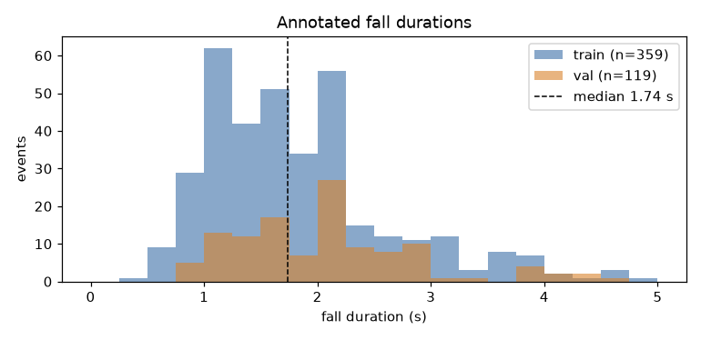
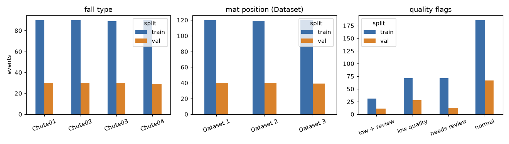
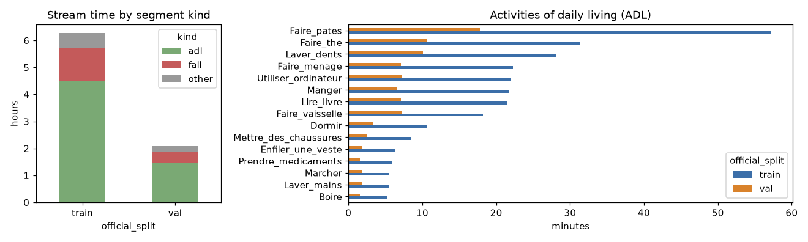
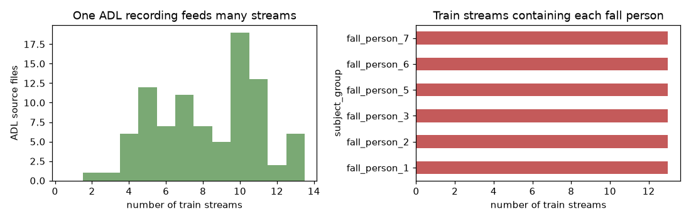
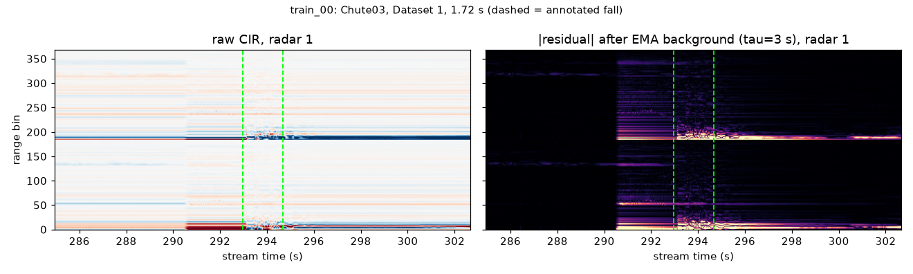
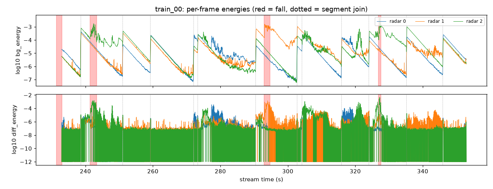
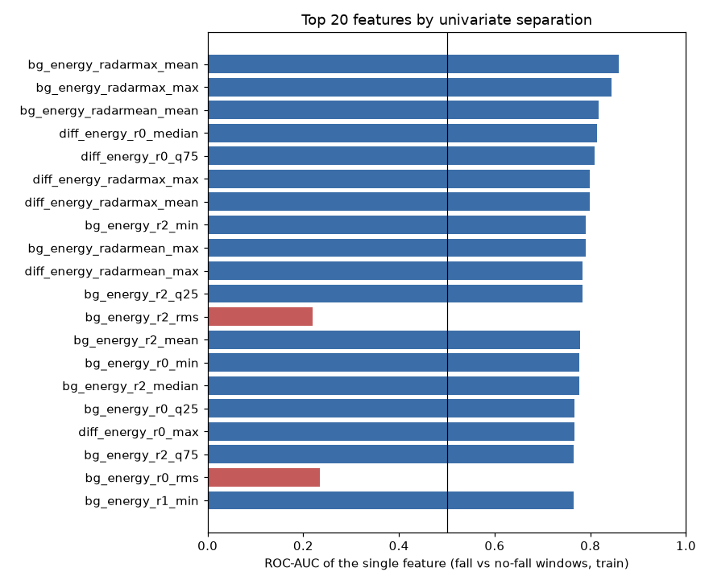
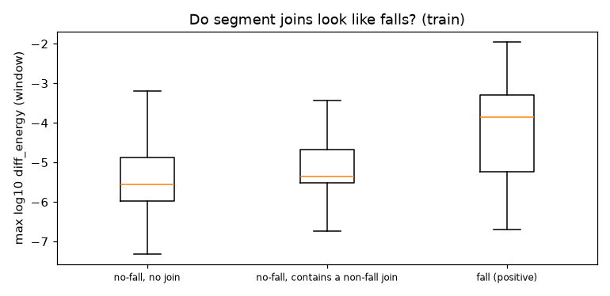
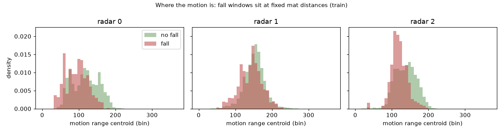

# Báo cáo NV2 — EDA và tiền xử lý dữ liệu UWB-FallTrack

*Người thực hiện: sangkhoi · Ngày: 2026-10-22 · Dữ liệu: `abc2027_uwb_train_v1` (bản phát hành chính thức)*

Có thể tạo lại báo cáo này bằng:

```bash
python scripts/inspect_data.py --config configs/baseline.yaml --out outputs/inspection/full_scan
python scripts/make_eda_report.py --config configs/baseline.yaml --inspection outputs/inspection/full_scan/inspection.json
```

Notebook đi kèm: [`notebooks/01_eda_preprocessing.ipynb`](../notebooks/01_eda_preprocessing.ipynb). Số liệu gốc: [`reports/eda_stats.json`](eda_stats.json).

**Nguyên tắc.** Thống kê mô tả (đếm, thời lượng) dùng cả train lẫn val. Mọi phân tích tín hiệu và đặc trưng chỉ dùng **train**, để val không ảnh hưởng tới các lựa chọn thiết kế. Thư mục `segments/` (bản ghi nguồn LIARA) không được đọc, vì README của gói cấm dùng bản ghi nguồn để train hoặc suy luận.

**Nguồn dữ liệu.** Số liệu và hình trong báo cáo này được nhóm tính và vẽ từ bộ dữ liệu ABC 2027 UWB-FallTrack (`abc2027_uwb_train_v1`), © 2026 LIARA Laboratory, Université du Québec à Chicoutimi, phát hành theo giấy phép [CC BY-NC 4.0](https://creativecommons.org/licenses/by-nc/4.0/). Báo cáo không chứa bản sao dữ liệu hay nhãn và chỉ dùng cho mục đích phi thương mại.

---

## 1. Tóm tắt

| Phát hiện | Hệ quả cho pipeline |
|---|---|
| Dữ liệu sạch: 18 luồng, 0 NaN/Inf, timestamp đều 50 Hz | Không cần nội suy hay làm sạch, chỉ cần kiểm tra tự động |
| Cú ngã rất ngắn (trung vị 1,74 s) và hiếm (3% thời gian) | Dùng cửa sổ ngắn (1 s, bước 0,2 s), class weight, và metric không dựa trên accuracy |
| Mỗi người ngã xuất hiện trong **cả 13** luồng train; mỗi file ADL nằm trong 2–13 luồng | **CV phải chia theo người**; chia theo luồng sẽ rò rỉ hoàn toàn |
| Phản xạ tĩnh chiếm ưu thế trong CIR thô | Trừ nền bằng EMA nhân quả (`tau = 3 s`) trước khi tính năng lượng |
| Mỗi chỗ nối đoạn để lại phần dư EMA giảm dần trong vài giây | Rủi ro báo động giả sau chỗ nối (đã xác nhận ở NV3) |
| Khoảng 26% frame là bản sao của frame trước (radar gốc khoảng 37–38 Hz) | Cửa sổ ngã có ít frame lặp hơn, đây là một đặc điểm của cách ghi dữ liệu |
| Chuyển động khi ngã nằm ở các khoảng cách cố định (vị trí thảm) | Mặc định không dùng đặc trưng vị trí, vì đó là đường tắt |

---

## 2. Schema và chất lượng dữ liệu

Đã quét toàn bộ 18 file, đọc theo khối 5 000 frame, không đọc nguyên cả luồng vào RAM.

| Thuộc tính | Giá trị quan sát |
|---|---|
| `cir` | `(3, T, 368)`, float32, giá trị thực, chunk `(3, 5000, 368)`, không nén |
| Ý nghĩa các trục | radar × thời gian × range bin. Trục thời gian được xác nhận nhờ `len(t) == T` |
| `t` | float64, đơn vị giây, `t[0] = 0`, `diff(t)` ∈ [0,019999…, 0,020000…] → **50 Hz**, tăng đơn điệu |
| `radar_serials` | `[29171, 29444, 30722]` ở mọi file |
| Attribute | `split`, `stream_index`, `seed = 2027`, `fade_s = 0,2` |
| NaN/Inf | **0** trên toàn bộ dữ liệu |
| Frame toàn 0 | 0 |
| Biên độ (train_00) | std khoảng 7e-4–1e-3 tùy radar, \|giá trị\| < 0,042 |

| Split | Luồng | Giờ | Cú ngã | Ngã/giờ | Bị gắn cờ | % thời gian là ngã | Giờ ADL | Giờ đoạn ngã | Giờ "other" | Số nhóm người |
|---|---|---|---|---|---|---|---|---|---|---|
| train | 13 | 6,18 | 359 | 58,1 | 173 (48%) | 2,95 | 4,49 | 1,22 | 0,57 | 12 |
| val | 5 | 2,05 | 119 | 58,1 | 52 (44%) | 3,35 | 1,47 | 0,42 | 0,19 | 4 |

Phần lớn các luồng dài khoảng 29 phút, riêng `train_12` dài 19 phút và `val_04` dài 5 phút. Cột `ignore` trong `streams_events.csv` đều bằng `false`. Cờ chất lượng chỉ có tác dụng khi chấm với `--ignore-flagged`, và đây là cách chấm của tập test.

---

## 3. Nhãn: các cú ngã



- Độ dài: trung bình 1,89 s, trung vị **1,74 s**, P10 1,03 s, P90 2,99 s, từ 0,48 đến 5,0 s.
- Biên của nhãn có sai số ±0,5–1 s (README), vì đồng hồ radar ghi theo giây Unix nguyên.



- 4 loại ngã (`Chute01`–`Chute04`) được phân bố đều, khoảng 120 cú mỗi loại.
- 3 vị trí thảm (`Dataset 1`–`3`) cũng đều, khoảng 160 cú mỗi vị trí.
- Gần một nửa số cú ngã bị gắn cờ `quality = low` hoặc `needs_review`, phần lớn thuộc Dataset 3. Trên test, các cú ngã này là vùng ignore: không bị tính là bỏ sót, và dự đoán chạm vào chúng (nới rộng ±2 s) không bị tính là báo động giả.

---

## 4. Cách luồng được tạo ra, và vì sao phải chia theo người



Mỗi luồng là chuỗi các đoạn ADL (15 hoạt động, nhiều nhất là `Faire_pates`), đoạn ngã (mỗi đoạn được cắt rộng hơn cú ngã 3–8 s về trước và 5–10 s về sau), và đoạn "other" (phòng trống, bản ghi khác). Hai đoạn liền nhau được nối bằng crossfade 0,2 s.



- Mỗi file ADL nguồn được cắt ra và dùng lại trong **2–13 luồng train** (trung vị 8,5).
- Mỗi người ngã (gom cả ba vị trí thảm) xuất hiện trong **cả 13 luồng train**.
- Vì vậy, nếu chia fold theo luồng thì mọi người đều có mặt ở mọi fold, tức là rò rỉ hoàn toàn.

Định danh người được suy ra từ đường dẫn nguồn trong `streams_composition.csv`:

- `falls/Dataset d/Test_Pd_k/...` → `fall_person_k`;
- `activities/<Activity>_n.json` → `adl_subject_n`.

Các mã này **không giao nhau** giữa train (người ngã 1, 2, 3, 5, 6, 7; ADL 4, 5, 6, 9, 10, 12) và val (người ngã 8, 9; ADL 0, 11). Điều này khớp với tuyên bố "train/val/test dùng người khác nhau" của ban tổ chức. Đây vẫn là **giả thuyết có bằng chứng**, chưa được ban tổ chức xác nhận trực tiếp.

---

## 5. Tín hiệu và tiền xử lý

### 5.1 Trừ nền tĩnh



Ở CIR thô, các vạch ngang (phản xạ tĩnh của tường và đồ đạc) chiếm ưu thế. Cú ngã (giữa hai vạch xanh) chỉ là thay đổi nhỏ trên nền đó.

Bộ lọc EMA **nhân quả** được áp dụng theo từng radar và từng bin:

`s_t = α s_{t-1} + (1-α) x_t`, `α = exp(-1/(50·τ))`, phần dư `y_t = x_t - s_t`.

Bộ lọc này giữ lại phần chuyển động.

- Nó không học tham số từ dữ liệu, nên không thể gây rò rỉ giữa các split.
- Nó chạy theo từng khúc và mang trạng thái từ khúc trước sang khúc sau. Test xác nhận kết quả giống hệt khi lọc cả luồng một lần, và giống hàm `subtract_background` của gói.

Hình trên cũng cho thấy **chỗ nối** ở khoảng 290,6 s: nền tĩnh đổi đột ngột vì đoạn ngã đến từ một bản ghi khác, phòng khác.

### 5.2 Năng lượng theo frame



Mỗi frame được tóm tắt thành hai chuỗi cho mỗi radar:

- `bg_energy = Σ_bin y²` (năng lượng phần dư);
- `diff_energy = Σ_bin (x_t − x_{t−1})²` (năng lượng sai phân).

Có hai quan sát quan trọng:

1. **Dạng răng cưa của `bg_energy`.** Tại mỗi chỗ nối (đường chấm), phần dư nhảy lên rồi giảm theo hàm mũ với hằng số `τ`. Cú ngã (vùng đỏ) tạo đỉnh năng lượng, nhưng ngay sau một chỗ nối cũng có đỉnh tương tự. Ở NV3, đây chính là nguồn báo động giả lớn nhất.
2. **`diff_energy` thường chạm sàn log (−12).** Nghĩa là nhiều frame giống hệt frame trước, xem mục 5.3.

### 5.3 Frame bị nhân bản

| Loại đoạn | Tỉ lệ frame lặp (trung bình) | Khoảng | Tần số gốc suy ra |
|---|---|---|---|
| ADL | 0,267 | 0,08–0,54 | 36,6 Hz |
| Đoạn ngã | 0,240 | 0,15–0,32 | 38,0 Hz |
| Other | 0,280 | – | 36,0 Hz |

Radar gốc chạy khoảng 37–38 Hz. Gói dữ liệu căn về lưới 50 Hz bằng cách lấy frame gần nhất (`align.py`), nên khoảng một phần tư số frame bị nhân bản.

Ở mức cửa sổ, **tỉ lệ frame lặp trong cửa sổ ngã thấp hơn hẳn**: trung vị 0,14, so với 0,28 ở cửa sổ không ngã (AUC 0,36, tương đương 0,64 nếu đảo chiều; đo trên 3 luồng train). Đây là đặc điểm của cách ghi dữ liệu chứ không phải tín hiệu vật lý của cú ngã. Các đặc trưng thống kê thấp của `diff_energy` (min, q25) phần nào mã hóa đặc điểm này. Tập test được tạo bằng cùng quy trình nên khả năng cao vẫn có đặc điểm này, nhưng đây là rủi ro về tính tổng quát cần ghi nhận.

### 5.4 Chọn hằng số thời gian τ (chỉ trên 3 luồng train)

| τ (s) | AUC `bg_energy_radarmax_mean` | AUC `bg_energy_radarmax_max` |
|---|---|---|
| 1 | 0,824 | 0,817 |
| **3** (baseline) | 0,876 | 0,862 |
| 8 | 0,899 | 0,889 |

τ lớn hơn tách lớp tốt hơn ở mức từng đặc trưng. Một phần là vì phần dư sau cú ngã (người nằm trên sàn làm nền thay đổi) kéo dài lâu hơn. Nhưng điều đó lại làm phần dư kéo dài quá thời điểm kết thúc cú ngã, nên có thể hại tIoU. Baseline giữ τ = 3 s giống baseline chính thức; ảnh hưởng của τ = 8 s ở mức sự kiện được đo bằng ablation ở NV3.

---

## 6. Cửa sổ và nhãn

Cửa sổ có độ dài cố định, bước 0,2 s, nằm trọn trong một luồng. Nhãn được gán theo `coverage = overlap / min(độ dài cửa sổ, độ dài cú ngã)`: dương nếu ≥ 0,5, âm nếu không chạm cú ngã nào, còn lại là mơ hồ.

| Cửa sổ | Dương | Âm | Mơ hồ | % dương | Cú ngã có ít nhất 1 cửa sổ dương | tIoU nếu 1 cửa sổ = 1 sự kiện (cú ngã dài trung vị) |
|---|---|---|---|---|---|---|
| 0,5 s | 3 275 | 107 121 | 852 | 2,94 | 100% | 0,29 |
| **1,0 s** | 3 337 | 106 170 | 1 709 | 3,00 | 100% | 0,57 |
| 2,0 s | 4 043 | 104 310 | 2 798 | 3,64 | 100% | 0,87 |
| 4,0 s | 7 192 | 100 614 | 3 215 | 6,48 | 100% | 0,44 |

Cột cuối giải thích vì sao baseline logistic 4 s của ban tổ chức gần như bằng 0 ở θ = 0,5: tIoU của nó bị chặn quanh 0,4, đúng như README nói.

Baseline của nhóm không coi mỗi cửa sổ là một sự kiện. Nó ghép các cửa sổ liên tiếp vượt ngưỡng thành **một run**, rồi lấy khoảng của sự kiện theo tâm của các cửa sổ. Vì vậy cửa sổ ngắn (1 s) cho biên chính xác hơn mà vẫn đủ ngữ cảnh. Sau khi gán nhãn, tập train có 111 216 cửa sổ: **3 328 dương (3,0%)**, 106 170 âm, 1 718 mơ hồ (bị loại khỏi tập huấn luyện).

---

## 7. Đặc trưng: khả năng tách lớp khi dùng riêng lẻ (train)



Có 86 đặc trưng: 12 thống kê × 2 chuỗi × 3 radar, cộng max/mean qua các radar, cộng độ tương phản so với 5 s trước đó. Mạnh nhất khi dùng riêng lẻ:

| Đặc trưng | AUC |
|---|---|
| `bg_energy_radarmax_mean` | 0,859 |
| `bg_energy_radarmax_max` | 0,844 |
| `bg_energy_radarmean_mean` | 0,817 |
| `diff_energy_r0_median` | 0,815 |
| `diff_energy_r0_q75` | 0,809 |
| `diff_energy_radarmax_max` | 0,799 |

Các đặc trưng gom qua các radar (max/mean) mạnh nhất, vì cú ngã thường rõ nhất trên một radar nhưng không cố định là radar nào. Không có đặc trưng đơn lẻ nào vượt 0,86, nên cần một mô hình kết hợp nhiều đặc trưng.

---

## 8. Kiểm tra đường tắt (shortcut)

### 8.1 Chỗ nối giữa các đoạn ghép



| Nhóm cửa sổ (train) | Số cửa sổ | Trung vị max log10 `diff_energy` | P90 |
|---|---|---|---|
| Không ngã, không chứa chỗ nối | 100 730 | −5,56 | −4,25 |
| Không ngã, chứa chỗ nối giữa hai đoạn không phải ngã | 5 440 | −5,35 | −4,15 |
| Ngã (dương) | 3 328 | −3,85 | −2,98 |

Bản thân crossfade 0,2 s **không** trông giống một cú ngã trong `diff_energy`. Tuy vậy, phần dư EMA trong `bg_energy` kéo dài vài giây sau chỗ nối (mục 5.2). NV3 đo được rằng 62,5% báo động giả (OOF train) rơi vào vùng 3 s sau một chỗ nối, trong khi vùng này chỉ chiếm 27% thời lượng.

### 8.2 Vị trí



Trọng tâm range của chuyển động trong cửa sổ ngã gần radar hơn (trung vị bin 95 so với 118 ở radar 0; 118 so với 139 ở radar 2). AUC là 0,31 / 0,40 / 0,31, tương đương 0,69 / 0,60 / 0,69 nếu đảo chiều. Nguyên nhân là ngã luôn xảy ra trên ba tấm thảm cố định, còn ADL ở chỗ khác (README gọi đây là "known limit"). Đặc trưng `range_centroid` **mặc định tắt**. Mức đóng góp của nó được đo bằng ablation ở NV3.

---

## 9. Quyết định tiền xử lý (đưa vào `configs/baseline.yaml`)

1. Đọc HDF5 theo khối 5 000 frame, không giữ nguyên CIR của cả luồng trong RAM. Chỉ lưu cache chuỗi năng lượng theo frame (khoảng 4 MB mỗi luồng).
2. Kiểm tra bắt buộc trước khi train: shape `(3, ·, 368)`, float32, bước 0,02 s, đơn điệu, NaN/Inf, nhãn nằm trong luồng, composition đầy đủ.
3. Trừ nền bằng EMA nhân quả với τ = 3 s; tính `bg_energy` và `diff_energy` theo từng radar và lấy log10.
4. Cửa sổ 1 s, bước 0,2 s; nhãn theo chồng lấn; loại cửa sổ mơ hồ khỏi tập huấn luyện; cú ngã bị gắn cờ vẫn là dương khi train.
5. Chia split chính thức; CV bên trong train chia theo `subject_group`, có purge cửa sổ vắt qua hai fold.
6. Không dùng `segments/`; không dùng đặc trưng vị trí (mặc định).

## 10. Câu hỏi mở và rủi ro

- Thư mục `segments/` có thuộc diện "source recordings" bị cấm không? Nhóm hiện không dùng nó.
- `fall_person_k` và `adl_subject_n` có đúng là mã người không? Hiện chỉ suy ra từ việc chúng tách rời giữa train và val.
- Ba đặc điểm của bộ dữ liệu (vị trí thảm, phần dư sau chỗ nối, tỉ lệ frame lặp) có thể khiến điểm số phản ánh **quy trình tạo luồng** nhiều hơn là khả năng phát hiện ngã thực sự. Hướng giảm thiểu đề xuất cho vòng sau:
  - tính `diff_energy` chỉ giữa các frame khác nhau;
  - làm cho nền "quên" nhanh tại chỗ nối, hoặc dùng nền dạng median;
  - dùng đặc trưng chuẩn hóa không phụ thuộc radar.
